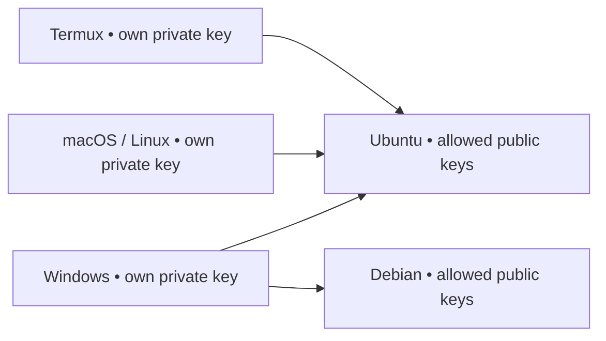

<a id="multi-device-ssh-key-architecture-guide-cloud--ec2"></a>

# 🔑 SSH from all your devices

**Connect to your servers with one short command, while keeping a separate SSH key on each device.**

Works with Windows, macOS, Linux and Android Termux clients connecting to Linux servers, including Ubuntu and Debian on EC2. Optionally, your normal SSH command can wake a stopped EC2 instance before connecting.

> [!TIP]
> **What you'll do:** choose which devices can reach which servers, create their keys, add public keys to the servers, then test a connection.
> **You need:** OpenSSH on each client and an existing way into each server. Auto-wake also needs Python and an existing wake deployment.
> **Already set up?** Reuse verified working keys and aliases. Only change what is needed.

[Plan](#plan) · [Create keys](#keys) · [Server setup](#server) · [SSH shortcuts](#shortcuts) · [Auto-wake](#wake) · [Test](#test) · [Remove access](#revoke) · [Troubleshooting](#fix)

## 🧭 Before you start

- **Client** means your computer or phone. **Server** means the Linux machine you connect to.
- **▶ Run in** tells you where a command belongs. Setup commands change files on that device; verification commands are read-only unless stated otherwise.
- Replace every `<PLACEHOLDER>` before running a command. The same names are used throughout this guide.
- `~/.ssh` is the SSH folder in your home directory. On Windows it is normally `C:\Users\<USER>\.ssh`; in PowerShell, use `$HOME\.ssh`.

<a id="️-1-architecture--security-model"></a>
<a id="the-core-principle"></a>

### How the keys fit together

Each device keeps its **private key**. Only its **public key** (the `.pub` file) goes into the chosen server user's `~/.ssh/authorized_keys`. The server's own public **host key**, saved in the client's `known_hosts`, lets the client verify which server it reached.

<a id="architecture-diagram"></a>



You decide which connections are allowed. A phone can have access to development servers only, while office and personal computers have different access lists.

<a id="choosing-your-key-isolation-model"></a>

| Key choice | What it means | When to use it |
|---|---|---|
| **One key per device** — default | Reuse that device's public key across your own servers | Simple to manage |
| **One key per device and server** | A separate pair for every device/server combination | Stronger separation between environments |

> [!CAUTION]
> Keep private keys on their original devices. A shared-key model must be an explicit choice; this guide uses separate device keys. If a device is lost or compromised, [remove its access](#revoke) from every server that trusts it.

<a id="-2-ai-agent-interactive-setup--grill-me-protocol"></a>

<a id="plan"></a>
## 🤖 Plan with an AI assistant, or fill this in yourself

You can give an assistant this prompt:

```text
Follow multi_device_ssh_guide.md to set up SSH on my selected devices.
Inspect existing settings and ask only for missing information.
Ask whether I want optional EC2 auto-wake; if yes, configure and test it
on each selected client. Preserve working access and unrelated settings.
```

<a id="agent-interrogation-checklist-collect-first"></a>
<a id="-3-setup-planning-worksheet"></a>

### Settings to collect once

| Setting | What to record or ask |
|---|---|
| Devices and OS | Windows PowerShell, macOS/Linux, Android Termux; which devices can access each server? |
| Device label | A unique name such as `office-win`, `personal-laptop` or `phone` |
| Server and address | Which live server, and its exact IP or DNS name? |
| Login user | Usually `ubuntu` for Ubuntu, `admin` for Debian, or your custom account |
| SSH alias | A short name such as `ec2-ubuntu` or `ec2-debian` |
| Key choice | One per device, or one per device/server? Use a descriptive filename such as `id_ed25519_ubuntu_laptop` and unique comment such as `laptop-to-ubuntu-2026` |
| Passphrase | Ask the user's preference. Use an empty passphrase only when unattended access is intentionally required; a passphrase-protected key can use an SSH agent |
| Optional auto-wake | **“Should `ssh <ALIAS>` wake this EC2 instance when stopped? If yes, on which clients?”** Default: off |
| If auto-wake is selected | Existing `WakePageUrl`, its target instance, fixed or changing IP, and a local `~/.ssh/<ALIAS>-wake.pin` file. Never record the PIN here |
| Live wake test | Ask whether work is saved and the instance may be stopped for testing |

<a id="automated-agent-pre-flight-safety-checks-check-automatically-when-possible"></a>

### Before changing files

The setup agent must reuse session answers and inspect what it can, rather than repeat questions or assume placeholder values:

- Confirm fallback server access before changing `authorized_keys`: a working SSH session, or a verified console, EC2 Instance Connect, Serial Console or Systems Manager route.
- Check whether the key already exists. Do not overwrite it; report the collision and reuse a verified key or agree on another filename.
- Back up files that will change. Edit an existing `Host` block in place; preserve unrelated aliases, keys, ports and host verification.
- Inspect `ssh -G <ALIAS>` and the configuration sources, including `Include`, wildcard `Host`, `Match`, `ProxyCommand` and `ProxyJump`. Earlier matching settings can take precedence. Do not silently replace an existing proxy route.
- Check actual Windows ACLs with `Get-Acl` or `icacls`. Use Ed25519, `IdentitiesOnly yes`, and the file permissions below by default.

If auto-wake is selected, **install and configure it on every selected client**, using [the auto-wake steps](#wake). Do not stop at suggesting commands. Client setup does not authorize creating AWS infrastructure or changing the server's idle policy. If one device is unavailable, finish the others and report the exact blocker.

<a id="-5-client-side-setup-by-device"></a>

<a id="keys"></a>
## 💻 Step 1: Create a key on each client

Skip generation when reusing a verified key. The commands prompt for a passphrase; only for intentionally unattended access, add `-N ""`. Never overwrite an existing key at that prompt.

<a id="a-windows-powershell"></a>

### Windows

**▶ Run in: PowerShell on the client**

```powershell
New-Item -ItemType Directory -Force -Path "$HOME\.ssh" | Out-Null
ssh-keygen -t ed25519 -C "<UNIQUE_COMMENT>" -f "$HOME\.ssh\<KEY_FILENAME>"
icacls "$HOME\.ssh\<KEY_FILENAME>"
Get-Content "$HOME\.ssh\<KEY_FILENAME>.pub"
```

**You should see:** the key pair exists, and the final command prints a public key beginning with `ssh-ed25519`. Copy only that public line to the server.

If the private key grants other users access, restrict it and check again:

```powershell
$keyPath = "$HOME\.ssh\<KEY_FILENAME>"
$userSid = [Security.Principal.WindowsIdentity]::GetCurrent().User.Value
icacls $keyPath /inheritance:r
icacls $keyPath /grant:r "*${userSid}:(R)"
icacls $keyPath
```

These commands remove inherited permissions and grant your user read access. **Existing explicit grants remain:** inspect them and remove unwanted entries with `icacls $keyPath /remove:g "<UNWANTED_ACCOUNT_OR_SID>"`. Do not remove your own access. Recheck the final ACL; do not assume permissions were fixed just because the commands ran.

<a id="b-linux--macos-bash-or-zsh"></a>
<a id="c-android-termux"></a>

### macOS, Linux and Android Termux

**▶ Run in: the client's terminal**

On Termux, install OpenSSH first if missing:

```bash
pkg update -y && pkg install -y openssh
```

Then use the same key commands on all three platforms:

```bash
mkdir -p ~/.ssh && chmod 700 ~/.ssh
ssh-keygen -t ed25519 -C "<UNIQUE_COMMENT>" -f ~/.ssh/<KEY_FILENAME>
chmod 600 ~/.ssh/<KEY_FILENAME>
cat ~/.ssh/<KEY_FILENAME>.pub
```

**You should see:** a private key and a `.pub` file. The private key has mode `600` (`-rw-------`). Keep Termux keys in its private home, never Android shared storage.

<a id="-4-server-side-setup-cloud-instance"></a>
<a id="step-1-initialize-directory--lock-permissions"></a>
<a id="step-2-idempotent-key-installation-prevents-duplicates"></a>

<a id="server"></a>
## 🔒 Step 2: Add the public key to the server

> [!WARNING]
> Keep your working connection open. Test the new key in a **second terminal** before closing the old session or removing any old key.

**▶ Run in: the server, logged in as the intended SSH user**

```bash
mkdir -p ~/.ssh && chmod 700 ~/.ssh
touch ~/.ssh/authorized_keys && chmod 600 ~/.ssh/authorized_keys
cp ~/.ssh/authorized_keys ~/.ssh/authorized_keys.bak.$(date +%Y%m%d-%H%M%S)
sudo chown -R "$(id -un):$(id -gn)" ~/.ssh

PUB_KEY='<PASTE_THE_SINGLE_PUBLIC_KEY_LINE>'
grep -qxF "$PUB_KEY" ~/.ssh/authorized_keys || printf '%s\n' "$PUB_KEY" >> ~/.ssh/authorized_keys
chmod 600 ~/.ssh/authorized_keys
```

The check prevents duplicate **identical lines**. If a key's comment has changed, compare its key type and base64 key data before adding it; the same key does not need a second entry.

If configuring another account as an administrator, use that account's home and ownership instead: `sudo chown -R <SSH_USER>:<SSH_GROUP> /home/<SSH_USER>/.ssh`. Do not accidentally install the key for `root`.

**You should see:** the public key in the target user's `authorized_keys`, directory mode `700`, file mode `600`, and both owned by that user.

<a id="-6-client-ssh-config-one-word-shortcuts"></a>
<a id="configuration-snippets"></a>
<a id="on-windows-powershell"></a>
<a id="on-linux--macos"></a>
<a id="on-android-termux"></a>

<a id="shortcuts"></a>
## ⚡ Step 3: Give the connection a short name

All platforms use the **same SSH config format**. Open the client file below and add or update one block per server; avoid duplicate aliases.

**Create the file if needed.** These commands preserve an existing config.

**▶ Windows PowerShell:**

```powershell
New-Item -ItemType Directory -Force -Path "$HOME\.ssh" | Out-Null
$configPath = "$HOME\.ssh\config"
if (-not (Test-Path -LiteralPath $configPath)) {
    New-Item -ItemType File -Path $configPath | Out-Null
}
```

**▶ macOS / Linux / Termux terminal:**

```bash
mkdir -p ~/.ssh && chmod 700 ~/.ssh
touch ~/.ssh/config && chmod 600 ~/.ssh/config
```

Then edit the file:


| Client | File / editor |
|---|---|
| Windows | `notepad "$HOME\.ssh\config"` — save as `config`, not `config.txt` |
| macOS / Linux / Termux | Edit `~/.ssh/config` using your editor, then run `chmod 600 ~/.ssh/config` |

```sshconfig
Host <ALIAS>
    HostName <SERVER_IP_OR_DNS>
    User <SSH_USER>
    IdentityFile ~/.ssh/<KEY_FILENAME>
    IdentitiesOnly yes
```

<a id="configuration-best-practices"></a>

- `Host` is your shortcut, for example `ec2-ubuntu`. Use another block such as `ec2-debian` for another server, only on devices that should access it.
- `HostName` contains the address only, without `user@`. `User` is the remote login name.
- `IdentityFile` points to this device's private key. `IdentitiesOnly yes` avoids trying unrelated agent keys and exhausting the server's authentication attempts.
- Keep an existing custom `Port` or other required route settings. Verify the effective result with `ssh -G <ALIAS>`.

**Before trusting a new server:** compare its host-key fingerprint with one obtained through an existing trusted session or console. For an Ed25519 host key, run `ssh-keygen -lf /etc/ssh/ssh_host_ed25519_key.pub` on the server. A scan alone does not prove identity. Preserve verified `known_hosts` entries; never disable host checking or erase a mismatch merely to make login work.

**You should see:** `ssh <ALIAS>` opens the intended server as the intended user. Follow [the test checklist](#test) before closing your fallback connection.

<a id="wake"></a>
<a id="6a-optional-ec2-auto-wake-on-each-selected-client"></a>
## 🌅 Step 4: Optional — wake EC2 when you connect

With [ec2_up.py](https://github.com/manojvermamv/ec2-idle-stop-wake/blob/main/src/ec2_up.py), keep using `ssh <ALIAS>`. A running server connects immediately; a stopped one wakes, then the **same SSH request** continues. You do not need to retry.

| You need | Why |
|---|---|
| An existing [EC2 Idle Stop and Wake deployment](https://github.com/manojvermamv/ec2-idle-stop-wake/blob/main/SETUP.md) | Its wake URL starts the intended instance; verify the target from trusted deployment information |
| Python 3.6+ on each selected client | The helper runs locally using only the standard library; no client AWS CLI credentials are needed |
| The wake PIN and the device's SSH key | The PIN permits waking; SSH still uses the device's own key to log in |
| A working route to SSH | The helper does not open firewalls or create a VPN; keep any required VPN connected |

Starting EC2 resumes normal compute billing. Client auto-wake does not install or alter the server's auto-stop timer. If the wake deployment is missing, keep direct SSH working and get authorization for that separate AWS setup.

### A. Install the helper and find Python

**▶ Run on: every selected client**

Read the current upstream helper and setup instructions, choose a reviewed Git commit, and download:

```text
https://raw.githubusercontent.com/manojvermamv/ec2-idle-stop-wake/<COMMIT>/src/ec2_up.py
```

Save it as `~/.ssh/ec2_up.py`. Back up an existing copy first. Record the commit and SHA-256, and compare installed copies across clients. Download once during setup, not on every connection.

| Platform | Find a working interpreter |
|---|---|
| Windows | Run `python --version`, then `python -c "import sys; print(sys.executable)"`. Use that full path; a launcher opening the Microsoft Store is not a working interpreter |
| macOS / Linux | Check `python3 --version` and `command -v python3`; install Python through the platform's package manager if missing |
| Termux | Install missing tools with `pkg install python openssh`. Check `python --version`, `command -v python` and `printf '%s\n' "$HOME"` |

For Android automation, execute as the **Termux user**. ADB's shell is not automatically Termux. If `run-as com.termux` is unavailable, use an authorized Termux terminal route; do not root the phone or move secrets into shared storage to bypass this.

### B. Save the PIN locally

Have the user enter the PIN through a **local hidden prompt**, writing one line of UTF-8 without BOM to `~/.ssh/<ALIAS>-wake.pin`. Never put the PIN in chat, command arguments, shell history, SSH config, repository, logs or the handoff report. Reuse a valid file; check before replacing it.

| Client | Protect the file |
|---|---|
| macOS / Linux / Termux | SSH directory `700`, PIN file `600`; use Termux's private home |
| Windows | Restrict the PIN file ACL to the user and verify it, including explicit grants, as explained in Step 1 |

Also protect the helper and config from modification by other users. Transferring a PIN securely between devices needs the user's authorization; SSH private keys stay on their original devices.

### C. Add automatic wake to the existing alias

Back up the config. Keep its existing alias, user, port and device-specific key. Resolve any existing proxy conflict before adding these settings **inside that target's block**:

```sshconfig
    StrictHostKeyChecking yes
    ConnectTimeout 360
    ServerAliveInterval 30
    ServerAliveCountMax 3
    ProxyCommand "<ABSOLUTE_PYTHON_PATH>" "<ABSOLUTE_HELPER_PATH>" <WAKE_URL> %h %p --pin-file "<ABSOLUTE_PIN_PATH>"
```

Use real absolute paths, not `$HOME` or unresolved placeholders. On Windows, use forward slashes and quote paths containing spaces, for example `"C:/Users/<USER>/.ssh/ec2_up.py"`. Termux paths are normally under `/data/data/com.termux/files/usr/bin/` and `/data/data/com.termux/files/home/.ssh/`; discover them rather than assume.

| Address type | Configure it this way |
|---|---|
| **Fixed public IP** | Keep `HostName` and its trusted `known_hosts` entry. The helper tries that address for 3 seconds; if SSH answers, it skips the wake API. No new `HostKeyAlias` is needed |
| **Changing public IP** | Set `HostName <ALIAS>.invalid` to avoid trying an old address, and add `HostKeyAlias <ALIAS>`. Save the independently verified server host public key under that alias in `known_hosts` **before** enabling strict checking |
| **Private address / VPN** | Add `--private-ip` to the proxy command only with a working private route. This chooses the API-returned address, not the initial fast-path address: use a private `HostName` or `<ALIAS>.invalid` too |

The helper's default wait is 300 seconds; `ConnectTimeout 360` gives it time to finish. If you raise `--timeout`, raise SSH's timeout too. Verify the effective options with `ssh -G <ALIAS>` and complete the tests below. If setup breaks access, restore only the affected settings and diagnose before retrying.

<a id="-7-step-by-step-verification-pipeline"></a>

<a id="test"></a>
## ✅ Step 5: Test each device

**▶ Run in: a second client terminal**, while keeping fallback access open.

<a id="verification-steps"></a>

### Normal SSH checks

| Check | What should pass |
|---|---|
| Local key | Both private and `.pub` files exist; Windows ACLs or Unix `700`/`600` permissions are correct |
| Server key | The intended public key is in the correct user's `authorized_keys`; ownership and permissions match Step 2 |
| Direct login | `ssh -o IdentitiesOnly=yes -i <PRIVATE_KEY_PATH> <SSH_USER>@<SERVER_IP_OR_DNS>` logs into the intended server; add `-p <PORT>` if needed. For example, use `ubuntu` or `admin` as appropriate |
| Alias login | `ssh <ALIAS> 'hostname; whoami'` returns the expected machine and user; inspect `ssh -G <ALIAS>` for the correct identity and no unintended duplicate definitions |

**Quick permission checks — these do not change files:**

**▶ Windows client, PowerShell:**

```powershell
icacls "$HOME\.ssh\<KEY_FILENAME>"
```

**▶ macOS / Linux / Termux client:**

```bash
ls -ld ~/.ssh
ls -l ~/.ssh/<KEY_FILENAME> ~/.ssh/config
```

**▶ Server, as the intended SSH user:**

```bash
ls -ld ~/.ssh ~/.ssh/authorized_keys
```

**You should see:** Unix directories as `drwx------` (`700`), private keys and config/authorized-key files as `-rw-------` (`600`), and the intended owner. On Windows, review the ACL against Step 1, including explicit grants.

Direct login isolates key and address problems from alias mistakes. If global SSH rules apply even to direct addresses, account for those routes when interpreting the test.

<a id="required-client-verification"></a>
### Extra checks when auto-wake is enabled

1. **Check the effective config.** Confirm Python, helper and PIN paths, proxy, timeout and host verification. Test with the platform's actual SSH client, including Windows OpenSSH and Termux.
2. **Test the wake API without starting EC2.** Run:

   ```bash
   "<PYTHON>" "<HELPER>" <WAKE_URL> --pin-file "<PIN_PATH>" --no-wake --check
   ```

   In PowerShell, put `&` before the quoted executable. **Leave out the host argument** to force the API path. Expect running plus SSH reachable, or an explicit stopped/`--no-wake` result (which exits with an error because no connection was made). A fixed-IP fast-path success alone does not prove the PIN works.
3. **Test while running.** Run the alias login from the table above through the configured proxy.
4. **Test a cold wake, only with permission.** Save work, close sessions, stop the intended instance and confirm **stopped**. Run the same alias login. It should wake and log in without a retry. Record elapsed time and exit status; repeat a separate stop-and-wake cycle for every selected client.
5. **Check the server after reboot.** If it uses the idle timer, confirm the timer is active with the user's original settings. Do not shorten idle times to test the client.

If a cold test is deferred, report **not tested**. A terminal login does not prove an IDE integration works. Finish with a per-device report: aliases, installed paths, helper commit/hash, backups, test results, blockers and the instance's final state. Keep direct-access backups until successful login; report any unfinished client setup clearly.

<a id="daily"></a>
## ☀️ Everyday use and undo

| You want to… | Do this |
|---|---|
| Connect | `ssh <ALIAS>`; SSH-based editors can select that alias too |
| Finish work | Close SSH and editor connections so the server's idle timer can start counting down |
| Disable client auto-wake | Remove its `ProxyCommand` and restore prior host settings or the verified backup. Keep the SSH key. For a changing IP, set `HostName` to the current address before direct login |
| Undo client setup | Restore only the affected client configuration. Do not delete the AWS wake deployment as part of client rollback |
| Remove a device's access | Follow the next section on every server that trusts that device's key |

<a id="️-8-safe-key-revocation-by-unique-comment"></a>
<a id="safe-revocation-procedure-server-side"></a>

<a id="revoke"></a>
## 🗑️ Remove access for a lost or retired device

**▶ Run in: the server, as the affected SSH user**

1. Keep a working connection from another authorized device open.
2. Back up and review the file:

   ```bash
   cp ~/.ssh/authorized_keys ~/.ssh/authorized_keys.bak.$(date +%Y%m%d-%H%M%S)
   cat -n ~/.ssh/authorized_keys
   ```

3. Use the unique device comment to find the key, then verify its key data. Edit `~/.ssh/authorized_keys` and delete **only that device's entry**. Comments are labels, not identities: duplicate comments can name different keys. Do not automate deletion by line number or an unescaped comment pattern.
4. Run `chmod 600 ~/.ssh/authorized_keys`, review the result and confirm another authorized device still connects.

Repeat for every key/server pairing belonging to the device. Revocation blocks future authentication; existing sessions are not automatically disconnected. If the device also stored a wake PIN, rotate that PIN and update the remaining clients through the [wake project's runbook](https://github.com/manojvermamv/ec2-idle-stop-wake/blob/main/RUNBOOK.md).

<a id="-9-comprehensive-troubleshooting-matrix"></a>
<a id="diagnostic-mode-ssh--vvv"></a>

<a id="fix"></a>
## 🔧 Fix a problem

Start with `ssh -vvv <ALIAS>` (or add `-vvv` to your direct SSH command). `Will attempt key` shows which key SSH found; `Offering public key` shows what it sent. A return to `Authentications that can continue: publickey` after an offer means authentication has not succeeded. Never print the wake PIN during diagnosis.

<a id="common-issues--targeted-fixes"></a>

| You see | Check / fix |
|---|---|
| `Permission denied (publickey)` | Check username, chosen key and server `authorized_keys`. Inspect client ACLs and server ownership/permissions; this error alone does not identify the cause |
| `Permissions ... are too open` or a Windows key-permission warning | Apply Step 1's permissions and verify them. Unix private keys need `600`, SSH directory `700`; Windows explicit grants need inspection too |
| `Load key ... invalid format` | Check file contents and encoding. Copying through an editor can corrupt a key or its line endings. Restore the original valid key; writing different encoding cannot repair missing key data |
| `Too many authentication failures` | Set `IdentitiesOnly yes` with the intended `IdentityFile` |
| `Connection timed out` | Check the current address, VPN/route and firewall. For public EC2 SSH, allow the SSH port (usually 22) from your current public IP in the security group |
| `Connection refused` | Check the port and server SSH service with `sudo systemctl status ssh` or `sshd` |
| Host-key mismatch | Verify the server identity through a trusted route; investigate a replaced server or changed address before updating `known_hosts` |
| Helper cannot find Python or the PIN | Correct the absolute path, installation or file permissions; do not put the PIN in the command line |
| Wrong wake PIN or locked page | Stop guessing and use the [wake runbook](https://github.com/manojvermamv/ec2-idle-stop-wake/blob/main/RUNBOOK.md) |
| Wake API says running, but SSH fails | Check the SSH route, security group, port and sshd; running does not mean reachable |
| Wake API unavailable | Start EC2 through an authorized AWS route, then use direct SSH. A reachable fixed-IP fast path may still work without the API |

When a step fails, inspect what succeeded before retrying. Preserve working access, fix the specific cause, and rerun the failed check rather than create duplicate keys or config entries.
